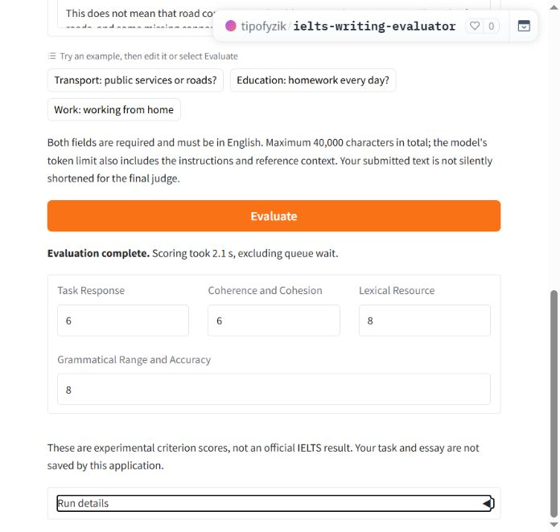

# IELTS Writing Evaluator

This project studies how prompt engineering can improve small language models (SLMs) on a specialised task. IELTS Writing Task 2 is the test case.

Try one of three sample essays or submit your own question and essay. The demo gives separate estimates from 0 to 9 for Task Response, Coherence and Cohesion, Lexical Resource, and Grammatical Range and Accuracy.

[Demo](https://tipofyzik-ielts-writing-evaluator.hf.space) · [Install](#install-and-run-locally) · [Kaggle](code/offline_research/notebooks/README.md) · [Docs](docs/README.md)



## Prompting approach

A small language model judges one essay at a time (Zheng et al., 2023). To measure the effect of prompting, we keep the judge model fixed and change what the prompt provides alongside the question and essay.

1. **IELTS rubric.** A condensed version of the official Task 2 band descriptors tells the judge what each band means for the four criteria.
2. **PANDA notes.** The original PANDA method retrieves explanations of an expert model’s preferences (Liu et al., 2024). In this adaptation, the notes start from scores already recorded in the training dataset. For each criterion, the prompt asks for evidence that supports the assigned band and for the strengths and weaknesses that distinguish it from its neighboring bands. The judge receives the scores and notes from a similar training essay.
3. **Preliminary scores.** A separate RoBERTa-based essay scorer estimates the four scores for the new essay from its text alone. The judge uses those estimates as guidance when making its own assessment.

## Demo verification

The hosted demo was checked with new essays, simultaneous requests and a restart. The checks also covered scoring through the local app. [Demo verification](docs/DemoVerification.md)

## Results

On Kaggle, we tested six prompt variants with Qwen2.5-1.5B-Instruct, the model used in the demo. Each variant ran once on the same 1,635 essays. The metrics are averaged across the four criteria.

| Scoring setup | QWK ↑ | RMSE ↓ | MAE ↓ |
| --- | ---: | ---: | ---: |
| Qwen with the base prompt | 0.027 | 2.127 | 1.724 |
| Qwen with rubric, PANDA notes and preliminary scores | 0.606 | 1.393 | 0.981 |
| Essay scoring model alone | 0.607 | 1.391 | 0.980 |

Quadratic weighted kappa (QWK) measures agreement on the ordered band scale. RMSE gives more weight to large errors. Both RMSE and MAE are in band points.

The full prompt reproduced 6,536 of the essay model’s 6,540 criterion scores. [Full results](docs/model_evaluation_report.md)

## Install and run locally

Use Python 3.11. From the repository root, install the local app.

```sh
python Manage.py install local
```

Copy [`.env.example`](.env.example) to `.env`. Use the [setup guide](docs/guides/04Installation.md) to configure Hugging Face, Supabase and access to a compatible model release.

Download the model and reference files, then start the app.

```sh
python Manage.py setup --download-assets --warm-cache
python Manage.py local
```

Open [http://127.0.0.1:7860](http://127.0.0.1:7860).

## References

- Liu, A., et al. (2024). *PANDA: Preference Adaptation for Enhancing Domain-Specific Abilities of LLMs*. Findings of ACL 2024, pp. 10960–10977. [ACL Anthology](https://aclanthology.org/2024.findings-acl.651/)
- Zheng, L., et al. (2023). *Judging LLM-as-a-Judge with MT-Bench and Chatbot Arena*. NeurIPS 2023. [Paper](https://arxiv.org/abs/2306.05685)
- IELTS (2023). *Writing Band Descriptors*, Task 2. [Official descriptors](https://ielts.org/cdn/ielts-guides/ielts-writing-band-descriptors.pdf#page=7)
