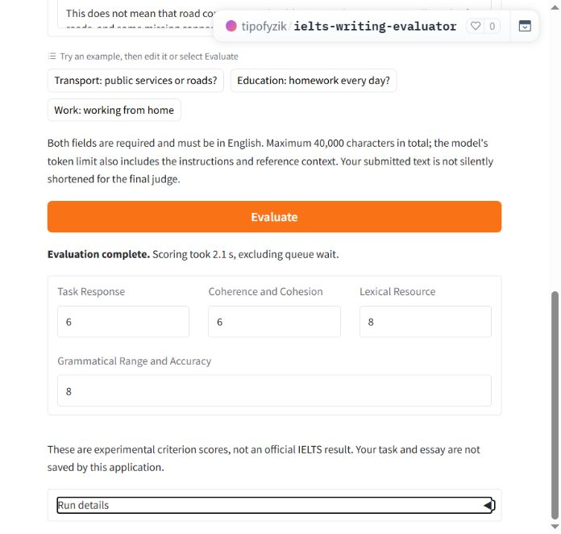

# Demo verification

These checks were run on 6 November 2026 for the hosted demo and local app.

## Source and hosting

The public demo was checked at Hugging Face revision `d93c3dcd304b0906684ee512904ba88cd596514d`. Its deployment source digest was `0ff4d47086c6d19a223ec9d929fcee4a6b7070b067a9b1a899d3a0f0b7ded678`. [Tested build](https://huggingface.co/spaces/tipofyzik/ielts-writing-evaluator/commit/d93c3dcd304b0906684ee512904ba88cd596514d)

## Automated and distribution checks

| Check | Result | Scope |
|---|---|---|
| Main regression suite | 219 passed | Runtime, contracts, datasets, notebooks, distribution and evaluation helpers |
| Legacy notebook suite | 39 passed, 1 skipped | Windows directory-symlink privilege skip |
| Deployment suite | 5 passed | Real source builder and isolated imports; controlled provider errors |
| Python total | 263 passed, 1 skipped | 264 tests; repeated runs are not added to this count |
| Clean source extraction | 89 passed | Portable subset without data, weights, settings or online services |
| SQL/PGlite | 22 passed | Local PostgreSQL/pgvector harness; production database unchanged |
| Source documentation audit | 94 classes, 784 functions/methods | Docstrings present; explicit function parameter/return annotations; no one-letter stored variables |
| Dependency direction | Passed | Shared source does not import the three components |
| Runtime/data preservation | 55 files identical | 46 local data files and 9 accepted runtime files compared by SHA-256 |
| Publication policy | Passed | Local `.gitignore` ignored; safe template/package markers allowed; secrets and private inputs excluded |

The 89 portable checks are a subset, not 89 additional tests. `Any` annotations mark dynamic boundaries; these results do not claim complete static type safety. Existing source labels, prompts, checkpoint weights and research findings are preserved.

## Real runtime acceptance

| Scenario | Observation |
|---|---|
| Three hosted examples | Transport 6/6/8/8; education 7/7/7/9; remote work 6/6/8/9; real AES/retrieval/Qwen |
| Fresh anonymous own input | 6/6/7/7; real reference retrieval and one judge attempt |
| Browser scoring | Russian interface 6/6/8/8; DE and EN preserved scores/input; editing Essay cleared scores |
| Separate browser session | English defaults and empty inputs/results |
| Empty/long rejection | Distinct errors before judge; zero judge attempts |
| Concurrent queue | Six submitted; five accepted, one HTTP 503; input hashes and languages verified |
| Local UI | HTTP 200 and 22 components in the project environment |
| Local fallback | Real AES/BGE/Supabase/remote judge returned 6/6/8/8 |
| CPU worker parity | Three examples; scores/lengths equal; maximum vector difference zero; error recovery and shutdown passed |
| Controlled HTTP failures | Four loopback scenarios recovered; explicit model doubles; production DB unchanged |
| Hosted restart | New runtime instance; fresh input succeeded about 77 seconds after restart started |
| Public/private boundary | 37 published source-file hashes verified; private artifact access and runtime file routes denied anonymously |

Detailed JSON, source manifests, logs and the previous deployment snapshot are retained locally under `results/demo/` and `.cache/demo-completion/`. These directories are not part of the public source distribution. Original code and local inputs are retained in the migration backup under TEMP.

[Model evaluation](model_evaluation_report.md) · [Documentation](README.md)
