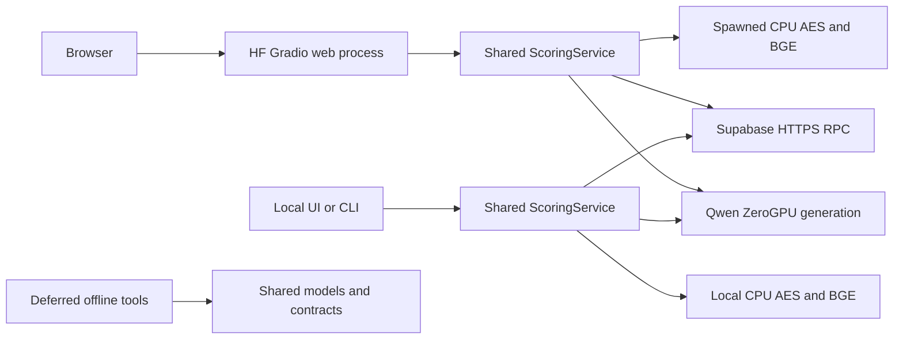

# Architecture and ownership

The three components depend on `shared`; shared modules never import a component. This keeps request behavior consistent while deployment, local transport and research remain independently owned.

`Manage.py` selects an interpreter and command; `RuntimeAssets.py` restores compatible runtime inputs. Neither entry point trains models during normal startup. The hosted CPU process isolates AES/BGE native inference from ZeroGPU's CUDA worker lifecycle. The scoring service admits one synchronous request and owns its deadline. Gradio owns the bounded waiting queue and session state.

Read the [shared block](../../code/shared/README.md), [public block](../../code/public_demo/README.md) and [local block](../../code/local_backup/README.md) for their actual files and interfaces.

[Documentation catalogue](../README.md)
