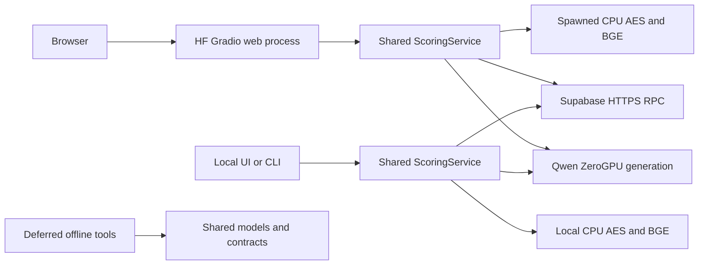

# Architecture

The hosted demo and the local app use the same scoring engine. It gathers a first estimate and a reference example, prepares the prompt for the judge, and checks the returned scores. The two apps run this work in different places.

## Where the work runs

- **Hosted demo.** Hugging Face serves the interface and runs the scoring engine. A separate CPU worker makes the first estimate and prepares the search query. The Space requests a GPU for Qwen when the prompt is ready.
- **Local app.** The browser interface and terminal command use a scoring engine running on your machine. Your CPU makes the first estimate and prepares the search query. The app looks up the example in Supabase, sends the assembled prompt to the hosted judge, and checks its reply locally. It needs an internet connection to reach both services.

## From submission to scores

1. **Check the input.** The scoring engine checks that the question and essay are present and that the judge has room for them.
2. **Make a first estimate.** An automated essay scoring model predicts four preliminary scores from the essay text. The judge later uses the actual question to assess Task Response.
3. **Find a similar essay.** An encoder turns the essay into a search vector. Supabase uses that vector to find similar training essays and uses the essay’s fingerprint to exclude the same text.
4. **Build the prompt.** The engine combines the question and essay with the IELTS rubric and the preliminary scores. When it finds a suitable example, it adds that example’s scores and PANDA notes. The notes describe how the example was scored. The preliminary scores give the judge a starting point for the current submission.
5. **Check the reply.** Qwen generates one reply. The engine checks that it contains four integer scores from 0 to 9 and returns them to the app. The app shows an error if the reply is invalid or a required service fails.

In both apps, the prompt sent to the judge contains the submitted question and essay. The search request to Supabase uses the essay’s vector and fingerprint. [Scoring flow](02ScoringFlow.md) · [Errors and privacy](06FailuresAndPrivacy.md)

## Where the model and examples come from

The research tools prepare scored essays for training and evaluation. They train the preliminary scorer and generate PANDA notes from the training essays’ existing scores. The reference set pairs those notes and scores with search vectors. The app loads the prepared model files at startup and searches the reference set already loaded into Supabase.

The Kaggle comparison runs the same scoring engine with a local copy of the reference set and a judge loaded in the notebook environment. It varies which parts of the prompt the judge sees and compares the results with the scores in the test set. [Kaggle](../../code/offline_research/notebooks/README.md) · [Evaluation report](../model_evaluation_report.md)

[Code tour](03CodeTour.md) · [Documentation](../README.md)
